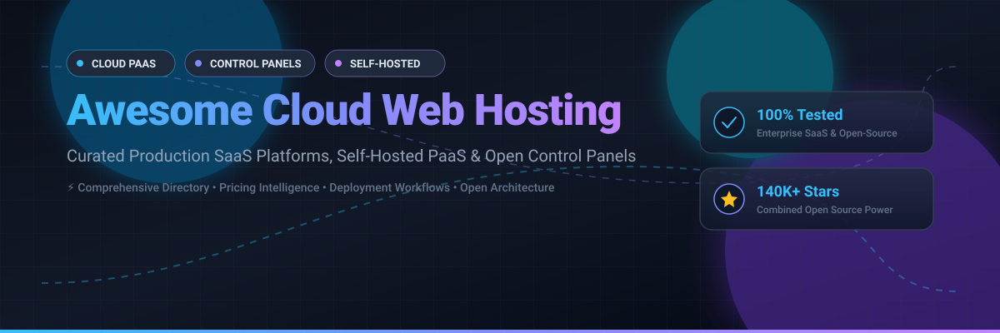

# Awesome Cloud Web Hosting 🚀

<div align="center">



<p align="center">
  <a href="https://github.com/ishandutta2007/Awesome-Awesome-Awesome"></a><a href="https://discord.gg/jc4xtF58Ve"></a>
  <a href="https://github.com/ishandutta2007/Awesome-Cloud-Web-Hosting/stargazers"></a>
  <a href="https://github.com/ishandutta2007/Awesome-Cloud-Web-Hosting/network/members"></a>
  <a href="https://github.com/ishandutta2007/Awesome-Cloud-Web-Hosting/blob/main/LICENSE"></a>
  <a href="https://github.com/ishandutta2007"></a>
</p>

<p align="center">
  <strong>🌟 Top Cloud Web Hosting, Self-Hosted PaaS & Modern Control Panels 🌟</strong><br>
  <em>A curated directory of premier commercial SaaS hosting providers and powerful open-source deployment platforms.</em>
</p>

</div>

---

## 📑 Table of Contents

- [🎯 Sector Overview & Market Dynamics](#-sector-overview--market-dynamics)
- [☁️ SaaS & Hosted Platforms](#️-saas--hosted-platforms)
- [💻 Open-Source GitHub Projects](#-open-source-github-projects)
- [🛠️ Architecture & Deployment Trade-offs](#️-architecture--deployment-trade-offs)
- [🤝 How to Contribute](#-how-to-contribute)
- [💖 Support](#-support)
- [📈 Star History](#-star-history)
- [⚠️ Disclaimer](#️-disclaimer)

---

## 🎯 Sector Overview & Market Dynamics

The global cloud web hosting and hosting services market is valued at approximately **$135B–$150B** (tracking toward **$300B+** over the next decade). The sector exhibits a bifurcated market structure:

- **Infrastructure Layer (Heavily Concentrated / Oligopolistic):** The foundational hyperscale compute and bare-metal layer is dominated by tech giants—chiefly Amazon Web Services (AWS), Microsoft Azure, and Google Cloud Platform (GCP)—commanding over 65% aggregate infrastructure market share.
- **Application & Retail Layer (Moderately to Highly Fragmented):** Across managed WordPress, polyglot PaaS, developer-centric clouds, and traditional server panels, hundreds of commercial hosts and open-source frameworks compete intensely. Differentiation hinges upon developer experience (DX), GitOps CI/CD pipelines, staging previews, enterprise SLAs, and security hardening.

---

## ☁️ SaaS & Hosted Platforms

| Platform | Revenue / Valuation | Starting Pricing | Free Tier / Trial Limits | Description & Best For |
| :--- | :--- | :--- | :--- | :--- |
| **[Shopify Secure Hosting](https://www.shopify.com/)** | ~$209.5B Market Cap ($11.6B FY25 Revenue) | $39/mo (Basic plan; $5/mo Starter) | 3-day free trial (no credit card required; store operates in sandbox/private mode with checkout inactive until plan selection) + $1/mo promo for first 3 mos | Fully managed commerce hosting with unmetered bandwidth, automated SSL, and 99.9% uptime SLA. Best for merchants wanting zero infrastructure management and peak-scale commerce hosting. |
| **[Acquia Cloud](https://www.acquia.com/)** | $1B Valuation ($350M+ ARR) | Quote-based (custom annual contract; historically from ~$141/mo) | 14-day free trial (no credit card required; full 3-environment Dev/Stage/Prod stack with built-in Cloud IDE and Drupal templates) | Enterprise Drupal WebOps platform with multi-site governance and 99.99% SLA. Best for large enterprises and digital experience portfolios on Drupal. |
| **[WP Engine](https://wpengine.com/)** | $1B+ Valuation (~$400M ARR) | $30/mo (Essential plan, billed annually) | No free tier; 60-day money-back guarantee (1 site, 25K visits, 10GB storage limit on entry tier) | Managed WordPress hosting platform with Genesis framework, SOC2/ISO 27001 compliance, and Git integration. Best for agencies and enterprises requiring enterprise SLAs and governance. |
| **[Pantheon](https://pantheon.io/)** | $1B+ Valuation ($100M–$250M ARR) | $55/mo (Basic Site plan) | Free forever Sandbox tier (up to 2 sandbox sites per account on `*.pantheonsite.io` subdomains, interstitial warning banner, dev/test/live workflows; no custom domain) | Container-based WebOps platform for WordPress, Drupal, and Next.js with Git-based multi-environment workflows. Best for development agencies and enterprise editorial teams. |
| **[Hostinger](https://www.hostinger.com/)** | ~$300M+ ARR (€275.4M FY25 Revenue) | $2.99/mo (Single/Premium plan with multi-year commitment; renews at regular rate) | No free hosting plan; 30-day money-back guarantee (includes 1 website, 50GB SSD, ~10K monthly visits). Standalone AI Website Builder has a 7-day free trial without credit card. | Budget-friendly shared, VPS, and cloud hosting with hPanel and AI tooling. Best for cost-conscious creators and small businesses wanting high-value hosting. |
| **[Cloudways](https://www.cloudways.com/)** | $350M Valuation (Acquired by DigitalOcean; ~$52M+ ARR) | $11/mo (DigitalOcean 1GB RAM / 1 vCPU server) | 3-day free trial (no credit card required; restricted to temporary subdomains and standard compute resources for testing 1-click installs) | Managed cloud hosting layer over DigitalOcean, AWS, and GCP with staging and automated backups. Best for developers and agencies wanting cloud flexibility without sysadmin overhead. |
| **[SiteGround](https://www.siteground.com/)** | $100M+ Est. ARR (Profitable, Bootstrapped) | $2.99/mo intro ($17.99/mo renewal for StartUp plan) | No free tier; 30-day money-back guarantee (includes 1 website, 10GB storage, ~10,000 monthly visits, free SSL, and daily backup). Standalone Website Builder offers 14-day trial. | Shared and cloud hosting optimized for WordPress with custom Site Tools and speed caching. Best for small businesses and publishers seeking dependable support and performance. |
| **[Nexcess](https://www.nexcess.net/)** | $100M–$500M Est. ARR (Parent: Liquid Web) | $21/mo (Spark plan for managed WordPress/WooCommerce) | No free tier; 30-day money-back guarantee (includes 1 site, 15GB storage, 2TB bandwidth). Free staging and automated plugin testing included. | Application-tuned managed hosting for WordPress, WooCommerce, and Magento with auto-scaling. Best for eCommerce merchants requiring dynamic traffic handling. |
| **[Platform.sh](https://platform.sh/)** | $180M+ Funding (~$40M–$57M ARR) | €12.25/mo (~$13.50/mo for Dev environment; production usage-based via Upsun) | 15-day free trial via Upsun (no credit card required; capped at 1 project, 2 running environments, 4.5 CPUs, 12GB RAM, and 20GB network storage) | Polyglot GitOps PaaS supporting 70+ languages/frameworks with instant production-clone preview branches. Best for modern dev teams seeking unified CI/CD hosting infrastructure. |
| **[Kinsta](https://kinsta.com/)** | ~$25M–$37M Est. ARR (Bootstrapped) | $35/mo (Single 35k plan; includes 1 site, 25K visits, 10GB storage) | First month free trial on Single 35k/Single 20GB plans (30 days at $0; fair-use resource caps apply; overages billed) + 30-day money-back guarantee; 100 free static sites forever. | High-performance managed WordPress and application hosting built on Google Cloud C2 VMs with MyKinsta dashboard. Best for developers and agencies wanting top-tier performance and clean UX. |

---

## 💻 Open-Source GitHub Projects

Curated open-source cloud hosting platforms, self-hosted PaaS solutions, and web control panels, **sorted descending by GitHub Stars_Count**. Each repository badge links directly to its live stargazers:

### 1. **[Coolify](https://github.com/coollabsio/coolify)** [](https://github.com/coollabsio/coolify/stargazers)
- **Category:** Self-Hosted PaaS & Heroku / Netlify Alternative (Apache-2.0)
- **Features:** Self-hostable, all-in-one PaaS supporting Git push deployments, native Docker & Docker Compose stacks, one-click databases (PostgreSQL, MySQL, Redis, MongoDB), preview environments, SSL automation, and server health monitoring.
- **Tech Stack:** PHP (Laravel), Livewire, Docker.
- **Best For:** Developers and teams desiring a modern, self-hosted cloud platform with zero vendor lock-in.

### 2. **[Dokku](https://github.com/dokku/dokku)** [](https://github.com/dokku/dokku/stargazers)
- **Category:** Docker-Powered Mini-Heroku PaaS (MIT)
- **Features:** The smallest, most mature PaaS implementation you've ever seen. Provides `git push` deployments driven by Docker buildpacks, Herokuish, or custom Dockerfiles, with a rich plugin ecosystem (Let's Encrypt, Postgres, MariaDB, Redis).
- **Tech Stack:** Bash, Go, Docker.
- **Best For:** CLI-centric developers wanting lightweight, Heroku-style simplicity on single VPS instances.

### 3. **[Cockpit](https://github.com/cockpit-project/cockpit)** [](https://github.com/cockpit-project/cockpit/stargazers)
- **Category:** Web-Based Linux Server Administration & System Dashboard (LGPL-2.1)
- **Features:** Clean, lightweight interactive web interface for Linux servers. Direct systemd integration, storage and LVM management, network configuration, container management via Podman, firewall rules, and interactive terminal sessions.
- **Tech Stack:** C, JavaScript, Python, systemd.
- **Best For:** Sysadmins and developers seeking official, modular web management for Linux cloud hosts without proprietary daemons.

### 4. **[CapRover](https://github.com/caprover/caprover)** [](https://github.com/caprover/caprover/stargazers)
- **Category:** Automated PaaS for Applications & Databases (Apache-2.0)
- **Features:** Extremely easy-to-use PaaS built on Docker Swarm. Supports multi-container orchestration, automatic SSL via Let's Encrypt, web GUI dashboard, CLI deployment tooling, and a 1-click application marketplace.
- **Tech Stack:** TypeScript, Node.js, Docker Swarm, Nginx.
- **Best For:** Solopreneurs and teams wanting effortless containerized deployments with cluster-ready scalability.

### 5. **[OpenPanel](https://github.com/openpanel-dev/openpanel)** [](https://github.com/openpanel-dev/openpanel/stargazers)
- **Category:** Modern Next-Gen Hosting Control Panel (GPL-3.0)
- **Features:** High-performance, Docker-isolated web hosting panel designed as a secure, resource-controlled cPanel alternative. Each user/domain runs in dedicated Docker containers with resource limits (CPU/RAM/IOPS), multi-PHP version switches, Nginx/Apache/Varnish caching, and a sleek modern UI.
- **Tech Stack:** Python, Go, Docker, Nginx.
- **Best For:** Hosting providers and developers seeking modern Docker sandboxing with traditional web hosting panel workflows.

### 6. **[Webmin](https://github.com/webmin/webmin)** [](https://github.com/webmin/webmin/stargazers)
- **Category:** Comprehensive Unix/Linux System Administration Panel (BSD-3-Clause)
- **Features:** The grandfather of open-source server control panels. Configures Apache, BIND DNS, Postfix mail, disk quotas, users, and cron jobs directly through browser interfaces by modifying native configuration files. Complemented by Virtualmin for web hosting management.
- **Tech Stack:** Perl, Unix system interfaces.
- **Best For:** System administrators requiring comprehensive, granular control over standard Linux distribution configs.

### 7. **[Tsuru](https://github.com/tsuru/tsuru)** [](https://github.com/tsuru/tsuru/stargazers)
- **Category:** Enterprise Open-Source Platform-as-a-Service (BSD-3-Clause)
- **Features:** Battle-tested, enterprise PaaS supporting Kubernetes and Docker backends. Offers autoscaling, multi-tenancy, service binding (databases, queues), Git-based deploy workflows, and detailed telemetry for high-scale enterprise clusters.
- **Tech Stack:** Go, Kubernetes, Docker.
- **Best For:** Organizations and engineering teams operating containerized PaaS platforms on top of Kubernetes.

### 8. **[HestiaCP](https://github.com/hestiacp/hestiacp)** [](https://github.com/hestiacp/hestiacp/stargazers)
- **Category:** Fast, Lightweight Web Server Control Panel (GPL-3.0)
- **Features:** High-performance, clean control panel for Debian/Ubuntu servers. Features fast Nginx + PHP-FPM / Apache caching stacks, automated Let's Encrypt certificates, multi-PHP selector, DNS/Mail server clusters, and native backup managers.
- **Tech Stack:** PHP, Bash, Nginx, Apache.
- **Best For:** Webmasters, digital agencies, and developers running high-speed LAMP/LEMP WordPress hosting setups on VPS nodes.

### 9. **[aaPanel](https://github.com/aaPanel/aaPanel)** [](https://github.com/aaPanel/aaPanel/stargazers)
- **Category:** Modular Web Hosting Server Manager (GPL-3.0)
- **Features:** Highly intuitive server management suite with one-click LNMP/LAMP stack installations, visual database management, FTP managers, crontab automation, and integrated app store modules.
- **Tech Stack:** Python, Shell script, Web GUI.
- **Best For:** Developers desiring a visual, component-rich control panel with instant extension installations.

### 10. **[Froxlor](https://github.com/froxlor/froxlor)** [](https://github.com/froxlor/froxlor/stargazers)
- **Category:** Lightweight Server Management & Hosting Panel (GPL-2.0)
- **Features:** Developed by experienced Linux administrators to be lightweight and strictly standards-compliant. Manages virtual hosts, multi-PHP configurations, Let's Encrypt SSL, directory protection, quotas, and email accounts.
- **Tech Stack:** PHP, MySQL.
- **Best For:** Administrators looking for a lightweight, transparent hosting management panel with no bloat.

### 11. **[Miabi](https://github.com/miabi-io/miabi)** [](https://github.com/miabi-io/miabi/stargazers)
- **Category:** Self-Hosted PaaS with Built-in Analytics & RBAC (Proprietary / Open Source Core)
- **Features:** Git push deploys, GitOps pull-based reconciliation, CI/CD pipelines, Docker Swarm clustering, marketplace templates, team RBAC, privacy-focused built-in web analytics, and audit logging.
- **Tech Stack:** Go, Vue 3, PostgreSQL, Redis, Docker.
- **Best For:** Teams wanting an integrated self-hosted PaaS with built-in telemetry and access controls.

### 12. **[Slate](https://github.com/CloudzyVPS/slate)** [](https://github.com/CloudzyVPS/slate/stargazers)
- **Category:** Minimalist, Auditable Control Panel (MIT / Open Core)
- **Features:** Ultra-lean single-binary (~13 MB) Go control panel with ~5 MB idle RAM footprint. Sites with isolated Unix users, PHP-FPM version switching (8.1–8.3), automated SSL, MySQL databases, and socket-driven privileged operations.
- **Tech Stack:** Go, server-rendered htmx templates.
- **Best For:** Developers and homelab hobbyists wanting an auditable, minimal-overhead control panel on Ubuntu.

---

## 🛠️ Architecture & Deployment Trade-offs

```
┌────────────────────────────────────────────────────────────────────────┐
│                   Managed Hosting vs. Self-Hosted                      │
├──────────────────────────────────┬─────────────────────────────────────┤
│ ☁️ Commercial SaaS Platforms      │ 💻 Open-Source & Self-Hosted PaaS    │
│ (WP Engine, Kinsta, Pantheon...) │ (Coolify, Dokku, CapRover...)       │
├──────────────────────────────────┼─────────────────────────────────────┤
│ • Full infrastructure management │ • Complete control of OS & hardware │
│ • 99.9% to 99.99% uptime SLAs   │ • Zero vendor licensing fees        │
│ • 24/7 dedicated tier-3 support  │ • You own backups, patches & uptime │
│ • Automated compliance & SOC 2   │ • High flexibility with Docker/K8s │
└──────────────────────────────────┴─────────────────────────────────────┘
```

> [!IMPORTANT]
> **Operational Responsibility**: Deploying open-source control panels or PaaS frameworks shifts operational burdens entirely to you. You are responsible for hypervisor tuning, kernel patches, DNS propagation, SSL renewals, firewall automation (UFW/iptables), data replication, and disaster recovery.

---

## 🤝 How to Contribute

Contributions are warmly welcomed! Help keep this directory accurate, objective, and up to date:

1. 🍴 **Fork the repository** on GitHub.
2. 🌿 **Create a feature branch** (`git checkout -b feature/add-new-platform`).
3. 📝 **Add or update entries** in `README.md` following our standard tabular/card structure:
   - Provide concrete starting prices and exact free trial / sandbox limits (avoid generic terms).
   - Link official documentation and transparent pricing pages.
   - For open-source repos, include the repository URL, description, and Stars_Badge.
4. 🚀 **Commit your changes** (`git commit -m 'feat: add platform xyz'`).
5. 📬 **Open a Pull Request** with a brief summary of additions and sources.

---

## 💖 Support

If you find this curated directory helpful for your infrastructure decisions, consider supporting the maintenance and continuous updates of this project:

- 🌟 **Star this repository** to help others discover it.
- 🍴 **Fork and share** with colleagues, DevOps teams, and web developers.
- ☕ **Sponsor the maintainer**: Support independent open-source research and tooling via the [GitHub Sponsors Dashboard](https://github.com/sponsors/ishandutta2007).

---

## 📈 Star History

[](https://star-history.dera.page/#ishandutta2007/Awesome-Cloud-Web-Hosting&type=date&legend=top-left)

---

## ⚠️ Disclaimer

- This is a **community-curated directory** provided for educational and architectural research purposes—it does not constitute an endorsement or commercial warranty.
- Always review cloud hosting terms of service, acceptable use policies, and compliance standards (GDPR, CCPA, HIPAA, PCI-DSS) prior to deploying production workloads.
- Pricing, trial policies, and product packaging change frequently. Always verify current tiers directly on respective platform websites.

---

<div align="center">
  <sub>Built with ❤️ for developers, DevOps engineers, and cloud architects worldwide.</sub>
</div>
